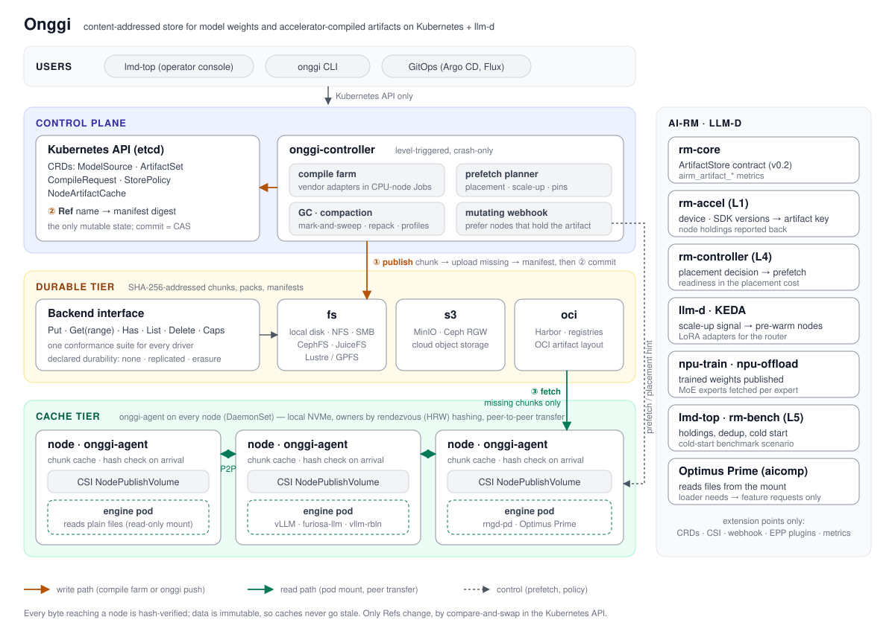

# Onggi

**Kubernetes + llm-d 환경을 위한 모델 가중치·가속기 컴파일 결과물 내용 주소 저장소**

[English](README.md) · 한국어

> 상태: **P2.** 설계는 [docs/ko/design.md](docs/ko/design.md)에 있습니다. `onggi push` / `pull`로 POSIX 마운트나 S3
> 서버에 결과물을 저장·복원하며 GC, 노드 캐시, peer, 델타 적용을 지원합니다. CSI 드라이버([deploy/csi](deploy/csi/README.md))는
> Kubernetes에서 결과물을 읽기 전용 볼륨으로 제공합니다. 컨트롤러(컴파일 팜, 프리페치)는 P3에서 이어집니다. 기존 방법과의
> 비교는 [docs/evaluation.md](docs/evaluation.md)에 있습니다.

실시간 델타 비교는 [대상 메타데이터 계획 재사용](docs/diff-plan-2026-10-30.md)으로
8B 부분 갱신 fixture의 CLI 시간을 8~14% 줄였으며, 변경 범위 출력은 동일합니다.

NPU는 모델을 미리 컴파일하며 모델 × SDK × 장치 × 길이 구간 × 배치 × 옵션 조합마다 결과물이 하나씩 생깁니다. 연구실
RNGD + ATOM 노드에서 Rebellions ATOM용 Llama-3.1-8B 빌드 묶음 하나가 **262 GB**를 차지합니다. 그래프마다 가중치가 통째로
들어 있기 때문입니다. FuriosaAI RNGD는 HF 체크포인트와 바이트가 같은 가중치를 세 벌 보관하고 있었습니다. 내용 기반
분할은 고정 블록으로는 전혀 보이지 않던 ATOM 변형 간 99.3% 공유를 찾아냅니다([측정](docs/ko/artifact-formats.md)).

Onggi(옹기)는 서로 다른 바이트를 한 번만 저장하고, 복원한 결과물을 엔진에 일반 파일로 넘깁니다. 현재 CSI 플러그인은
마운트 요청 시 복원하며, 배치 결정에 따른 자동 프리페치는 후속 구현입니다.

<p align="center"></p>

**목표 구조:** ① 컴파일 Job(또는 `onggi push`)이 결과물을 청크로 나눠 영속 계층에 없는 청크만 올리고 ② Kubernetes API의 Ref를
커밋합니다. ③ pod가 결과물을 마운트하면 그 노드의 agent가 없는 청크를 peer나 영속 계층에서 받아 모든 해시를 검증한 뒤 엔진에
일반 파일로 넘깁니다. Kubernetes Ref API, 컴파일 컨트롤러, ai-rm·llm-d의 배치·확장 신호에 따른 자동 프리페치는 후속 구현입니다.

## 하는 일

P3의 첫 단계로 [호환 프로필 선택·파일 사전 준비](docs/ko/compatible-prepare.md)를 지원합니다.
`push --profile FILE`로 게시하고 `prepare --request FILE --dir DIR <ref>...`로
호환 결과물을 골라 노드 캐시를 통해 검증된 파일을 완성한 뒤 게시합니다.
파일 준비 단계이며 NPU 예열과 배치·확장 신호 연동은 후속 작업입니다.

| | |
|---|---|
| **한 번만 저장** | 내용 기반 청크, 결과물별 매니페스트, 가중치는 배열 방식별로 한 벌 |
| **노드 데이터 재사용** | 노드 캐시와 해시 검증을 거치는 peer 전송; 배치·확장 신호에 따른 프리페치는 계획 단계 |
| **파일로 전달** | CSI 볼륨: kubelet이 준비된 결과물을 마운트; vLLM, vllm-rbln, furiosa-llm, rngd-pd, Optimus Prime 수정 불필요 |
| **선언형 빌드(계획)** | `ArtifactSet` CRD와 컴파일 팜; 현재는 기존 빌드를 `onggi push`로 게시 |
| **멀티 노드** | 영속 계층은 기존 이레이저 코딩 오브젝트 스토어; 캐시는 노드 장애를 전제로 설계 |

## 준비된 변형과 NPU 델타 로딩

Onggi는 미리 컴파일한 변형과 가중치를 기존 청크와 함께 일반 파일로 복원합니다. 실제로 배치·시퀀스 길이에 맞는 변형을
선택하고, 필요하면 처리 중인 요청을 비운 뒤 장치 메모리를 갱신하는 주체는 [rngd-pd](https://github.com/ai-computing/rngd-pd)
같은 서빙 런타임입니다. 파일 델타만으로 NPU 메모리가 바뀌거나 두 그래프가 상주 가중치를 공유할 수 있는 것은 아닙니다.

빌드마다 원본 체크포인트 식별자, 컴파일러·SDK, 장치, 가중치 배열 방식, 지원 배치·시퀀스 길이를 기록해야 합니다.
배치나 길이가 바뀌어도 호환되는 사전 컴파일 그래프가 필요합니다. RNGD 외부 가중치와 ATOM 장치 입력 가중치는 런타임 지원이
다르며, 가중치를 내장한 ATOM 그래프에는 해당 컴파일 결과물이 필요합니다. 자동 호환성 선택·예열·배치 연동은 후속 작업입니다.
[연계 설계](docs/ko/integration.md)를 참고하세요.

[상주 델타 갱신 기록](docs/ko/resident-delta.md)은 실제 Onggi 범위 조회와 RNGD 행 단위 갱신을 연결합니다.
Projection 64행은 논리 전송량 117MB → 1.84MB, LM 8행은 1.05GB → 64KiB로 줄었고,
768개 토큰이 새 전체 로딩과 일치했습니다. 이 실측은 SDK 2026.2 기준이며, SDK 2026.4 점검 결과와
별도 [실행 파일·캐시 로더 이식 작업](https://github.com/ai-computing/rngd-pd/pull/31)도 함께 기록했습니다.

## 빠른 시작

```bash
go build -o onggi ./cmd/onggi            # Go 1.24 이상
./onggi dedup-report --pairs 6 --fixed-block 1MiB <모델 저장소 경로>...
./onggi dedup-report --json <경로>... > report.json
```

경로를 훑어(심볼릭 링크는 따라가지 않음) 파일을 종류별(HF 원본, RNGD 변환 가중치·그래프·묶음, ATOM decode·prefill
`.rbln`)로 정렬해 원본이 먼저 오게 하고, 파일을 병렬로 내용 기반 분할(FastCDC, 기본 16/64/256 KiB)한 뒤 종류별 논리 크기,
고유 바이트, 앞선 종류 대비 새로 추가되는 바이트를 출력합니다. `--fixed-block`은 비교용으로 고정 크기 블록 측정을 함께
하고, `--pairs N`은 가장 큰 N개 파일끼리 서로 얼마나 겹치는지 보여줍니다.

결과물 저장·복원(저장소에 없는 청크만 청크 단위로 압축해 올리고, 복원할 때 모든 청크의 해시를 확인):

```bash
export ONGGI_STORE=/mnt/models/onggi        # 아무 POSIX 마운트: 로컬 디스크, NFS, SMB, CephFS, ...
# 또는 S3 서버(Ceph RGW, SeaweedFS, Garage, VersityGW, 클라우드). 버킷은 미리 만들어 둬야 함
export ONGGI_STORE='s3://models/onggi?endpoint=s3.lab.example:8333&insecure=1' AWS_ACCESS_KEY_ID=... AWS_SECRET_ACCESS_KEY=...
./onggi push --ref llama-3.1-8b@atom/pd <빌드 디렉터리>
./onggi pull llama-3.1-8b@atom/pd <복원 디렉터리>
./onggi ls; ./onggi inspect llama-3.1-8b@atom/pd
./onggi pull --cache /var/lib/onggi/cache llama-3.1-8b@atom/pd-b8 <디렉터리>   # 노드 캐시: 노드에 없는 것만 읽음
```

연구실 노드에서 ATOM Llama-3.1-8B 빌드 묶음 264 GB가 **15.9 GB**로 저장됩니다(push 3분, pull 5분, 원본과 바이트 단위
동일). 2단계 청크 분할이 새 ATOM 청크를 약 4 KiB 하위 청크로 다시 나눠서, 같은 가중치를 다른 순서로 담은 prefill
변형끼리 중복을 찾습니다(새 데이터 46.8 GB → 24.9 GB). 여기에 청크 단위 압축이 1.6배를 더합니다. `--compress none`,
`--sub 0`으로 각각 끌 수 있습니다.

`--cache DIR`를 주면 pull이 노드에 이미 있는 청크는 로컬 캐시 저장소에서 읽고, 새로 받은 청크는 캐시에 더합니다.
연구실 노드에서 ATOM decode 변형 하나(저장소에서 10.2 GB 읽음)를 받은 뒤, 두 번째 변형은 저장소에서 28 MB(0.3%)만,
prefill 빌드는 1.9 GB를 읽었고, 같은 변형을 다시 받을 때는 0 B를 읽었습니다. 모두 원본과 바이트 단위로 같았습니다.
CSI 플러그인은 쓰이지 않는 결과물을 지우고 노드 캐시를 스스로 정리합니다(#33).
`--peers`를 주면 pull이 노드에 없는 청크를 저장소보다 먼저 다른 노드의 캐시(`onggi peer serve`)에 묻습니다. 청크마다
rendezvous 해시로 고른 한 노드에서 받고 해시를 검증하며, peer가 주지 못한 청크는 저장소에서 읽습니다. 연구실 클러스터에서
CPU 노드가 NPU 노드의 캐시를 peer로 두고 S3 저장소에서 decode 변형(저장 10.2 GB)을 받았을 때 저장소에서 0 B, peer에서
10.2 GB를 읽었고 원본과 같았습니다(#34).
Kubernetes에서는 CSI 드라이버([deploy/csi](deploy/csi/README.md))가 ref를 읽기 전용 볼륨으로 마운트합니다. 노드는 결과물을
노드 캐시를 거쳐 한 번만 풀어 두고, 같은 ref를 쓰는 pod는 그 사본을 함께 씁니다. 연구실 클러스터에서 두 번째 decode 변형은
저장소에서 28 MB만 읽었습니다. init container로 pod의 emptyDir에 푸는 방법도 있습니다([deploy/k8s](deploy/k8s/README.md)).

정리(GC): `onggi rm-ref`로 ref를 지우면, `onggi gc`가 어떤 ref에서도 닿지 않는 데이터를 회수합니다(ADR-0005).
- 한 번 실행하면 참조되지 않는 객체를 후보로 기록합니다.
- `--grace`(기본 24시간)가 지난 뒤 다시 실행하면, 그때까지도 참조되지 않는 후보를 지웁니다. 단, push가 lease를 잡고 있으면 지우지 않습니다.
- 대부분 죽은 pack은 먼저 재압축(repack)합니다(`--repack 0.25`).

연구실 노드에서 ATOM 전체 묶음과 decode 변형 하나를 지우고 두 변형만 남겼더니, 네 번 실행해 pack이
15.9 GB에서 12.2 GB가 됐습니다(살아 있는 데이터 12.1 GB). 남은 두 결과물은 모두 원본과 바이트 단위로 같았습니다.
노드 캐시에는 ref가 없습니다. `onggi gc --store CACHE --roots-store S --keep-used 168h`를 실행하면 정한 기간 안에
이 캐시로 받은 결과물(pull이 사용 기록을 남김)이 필요로 하는 것만 남기고 나머지를 지웁니다. 연구실 노드에서 변형 세 개를
담은 캐시(12.2 GB)가 아직 쓰는 변형 하나만 남겨 10.2 GB로 줄었고, 그 변형을 다시 받을 때 저장소에서 읽은 양은 0 B였습니다.

`onggi diff --store S <기준> <ref>`는 노드에 있는 결과물을 다른 결과물로 바꾸는 데 무엇이 필요한지를 형식을 해석하지 않고
저장된 청크 단위로 보여 줍니다(#38). 같은 위치에 있는 바이트(그대로 둠), 기준 결과물의 다른 위치에 있는 바이트(로컬 복사),
새 바이트(받아야 함)로 나눕니다. 연구실 저장소에서:

| 기준 → 새 결과물 | 같은 위치 | 기준의 다른 위치 | 새 바이트 | 받을 양 | 바뀐 구간 |
|---|---|---|---|---|---|
| decode B2 → decode B8 (15.2 GB) | 98.6 %, 모두 4 KiB 블록 단위 | 0 | 1.4 % | 28.3 MB | 3개, 가장 큰 것 218 MB |
| decode B2 → prefill C128 (14.0 GB) | 0 | 79.4 % | 20.6 % | 1.9 GB | 1개 |

decode 변형끼리는 연속된 한 구간만 다르므로, 노드는 15 GB를 다시 쓰지 않고 사본을 제자리에서 고칩니다.
`onggi pull --base REF --base-dir DIR`은 DIR에 풀어 둔 결과물을 새 결과물로 바꾸면서 다른 부분만 씁니다(#41). CSI 플러그인은
pod가 쓰지 않는 결과물로 이렇게 합니다. 연구실 노드에서 decode B8을 B2 사본에서 5.7초(노드 캐시를 거치면 8.9초)에
만들었고, 일반 pull은 73.8초였습니다. 결과는 원본과 같았습니다.
prefill과 decode는 같은 가중치를 다른 순서로 담고 있습니다.

메모리:
- pull은 저장소 전체 색인이 아니라 결과물의 locator만 읽습니다. 이 묶음에서 기본 설정은 최대 3.6 GB RSS이고,
  `GOMEMLIMIT=1800MiB`(Go의 소프트 메모리 한도)를 주면 1.9 GB 아래로 유지됩니다. 노드 agent에는 이 한도를 설정하기를 권장합니다.
- push는 중복 제거를 위해 저장소 색인(압축 배열)을 메모리에 들고 있으며, 기본 설정에서 최대 1.9 GiB입니다(push 2분 24초).

## 문서

| | |
|---|---|
| [설계](docs/ko/design.md) | 문제, 목표, 품질 속성, 원칙, 구조, 흐름, 멀티 노드 저장, 로드맵 |
| [결과물 형식](docs/ko/artifact-formats.md) | RNGD·ATOM 결과물의 구성과 공유 비율(실측) |
| [연계](docs/ko/integration.md) | ai-rm 구성요소, lmd-top, llm-d와의 연결 |
| [관련 연구](docs/ko/related-work.md) | 구성요소별 선행 연구, 주장하지 않는 것, 차별점 |
| [ADR](docs/adr/README.md) | 구조 결정 기록 |

## ai-rm 구성요소

Onggi는 이종 AI 자원관리 스택 [ai-rm](https://github.com/ai-computing/ai-rm)의 구성요소입니다.
[rm-core](https://github.com/ai-computing/rm-core) 아티팩트 계약과 [lmd-top](https://github.com/ai-computing/lmd-top)
운영 콘솔 연동은 계획 단계이며, 현재 인터페이스는 CLI와 CSI 볼륨입니다.

## 기여

[CONTRIBUTING.md](CONTRIBUTING.md)를 참고하세요. 라이선스: [Apache-2.0](LICENSE).
