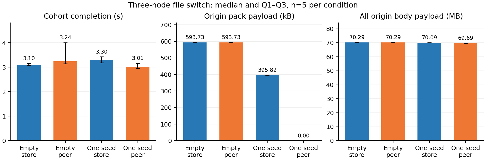

# E11: three simultaneous file-only variant switches, 2026-10-31

The existing peer path eliminated missing-chunk origin reads when one recipient
already held those chunks. Metadata dominated this transition: all successful
origin response bodies fell by **0.564740%**, rather than 100%. Empty snapshots
provided no peer payload. These observations do not establish a general latency
speedup or a dynamic cold-cache dissemination benefit.

## Cohort results

Each row contains five independent three-node cohorts (inclusive Q1/Q3 and IQR).
Four smoke cohorts are preserved but excluded; all 20 main cohorts succeeded
without retry or exclusion, yielding 60 main node samples. The statistical unit
is the cohort, not an individual node. Bytes below are summed across the three
recipients per cohort; byte counts were identical across all five repetitions.

| Initial target-chunk cache | Arm | Cohort median s | IQR s | Origin pack B | Peer chunk B | Local cache B | All origin body B |
|---|---|---:|---:|---:|---:|---:|---:|
| empty | store | 3.102097 | 0.068872 | 593,733 | 0 | 0 | 70,287,027 |
| empty | peer | 3.240237 | 0.866199 | 593,733 | 0 | 0 | 70,287,027 |
| one-seed | store | 3.295689 | 0.243164 | 395,822 | 0 | 197,911 | 70,089,116 |
| one-seed | peer | 3.014062 | 0.222896 | 0 | 395,822 | 197,911 | 69,693,294 |

The one-seed store/peer comparison is 70,089,116 -> 69,693,294 origin body
bytes, a reduction of 395,822 bytes (0.5647396%). Its pack component alone
falls 395,822 -> 0. Metadata stays **69,693,294 B per cohort** in all conditions.
There is no physical-network-byte or billing saving claim.

## Per-node completion

Completion is central release to receipt of that node's pull-completion marker;
it includes marker delivery. Each cell is median / IQR in seconds, n=5. CLI wall
time, base-copy time, post-pull hash time and cleanup are separate raw/summary
fields. The cohort ends at the last completion marker, before hash validation.

| Cache / arm | cpu-1 | cpu-2 | etri-001 |
|---|---:|---:|---:|
| empty / store | 3.083939 / 0.041270 | 3.086804 / 0.270764 | 2.680553 / 0.263195 |
| empty / peer | 3.240237 / 0.866199 | 3.107200 / 0.212630 | 2.809161 / 0.200419 |
| one-seed / store | 2.951378 / 0.039334 | 3.295689 / 0.243164 | 2.789280 / 0.247676 |
| one-seed / peer | 3.014062 / 0.145268 | 2.940180 / 0.308220 | 2.836878 / 0.291945 |

All 24 cohorts overlapped across the three workers. The largest centrally
received start skew was 2.470 ms. Latency distributions, small n, shared host
load and the instrumented origin do not justify a broad peer speedup claim.

## What was measured

- N=3 eligible amd64 nodes: cpu-1, cpu-2 and etri-001. Active physical NICs
  report full-duplex **1 Gb/s**, MTU1500 (eno1 on cpu nodes, ens4013f0 on etri).
  Other nodes were unreachable, cordoned or under DiskPressure; no node state
  was changed. The origin is colocated with the etri recipient.
- Complete existing B4/S256/g2 -> B4/S512/g2 artifacts, treated as opaque files:
  target nine files totaling **16,061,585,097 B**. Every worker in every smoke
  and main trial hashed all output bytes against the frozen target inventory.
- Store-only versus existing `onggi peer serve` static peers. This is the CLI
  peer path, not a CSI mount-latency experiment. Each trial has independent base
  inodes and a fresh target-chunk cache. Both arms have identical initial cache
  placement. Peer snapshots are ready before the barrier and do not forward
  newly fetched chunks during the same pull in the empty condition.
- A single central monotonic clock releases all ready workers. Arms alternate
  order across repetitions. Preparation, independent base copies, peer setup,
  target hashing and cleanup are outside the timed pull. OS page cache,
  background host/network load and storage writeback were not controlled.
- The one-seed setup was paid once before the matrix in both warm arms:
  63.559985 s independent base copy, 2.780853 s seed CLI pull (197,911 origin
  pack B), 39.336302 s full-file validation. These costs are not free or part
  of the timed switch. Bootstrap and per-trial preparation costs remain in raw.

## Origin byte interpretation

The proxy counts upstream response bodies before client writes and rejects a
cohort on any transfer error. Original request rows independently reproduce
every recorded counter. There were zero transfer errors. Empty/store has 990
requests: config 1,050 B / 3 GET, manifests 12,726 B / 6 GET, locator/list bodies
69,679,518 B / 6 GET, and packs 593,733 B / 6 GET plus 969 zero-body HEADs.
One-seed/peer has 984 requests, with the same metadata and pack HEADs but no
pack GET. Pack bodies exactly match the sum of CLI `read_bytes` in every cohort.

The large metadata bodies come from target/base locators in the measured
`plan()` / `chooseBase()` path, including referenced-pack existence probes for
GC fallback (`pkg/store/pull.go`, `pkg/store/rebase.go`). `OpenWith` is lazy;
this is not evidence of a complete global-index download. Peer chunk delivery
does not replace these metadata reads. This identifies a follow-up optimization
opportunity; the measured runtime was unchanged.

`read_bytes`, `peer_bytes` and `cache_bytes` count stored range/chunk payloads,
which may have different compression/framing. Successful origin body bytes
also include metadata. HTTP/TCP headers, control/barrier traffic, peer protocol
headers and unrelated NIC traffic are outside these counters. No disk, DMA,
physical NIC, inference or end-to-end Pod-startup measurement is claimed.
The Python proxy is present in every arm; no uninstrumented production S3
latency control was measured.

## Provenance, checks and cleanup

- Runtime: main `05c97605b07882f9ceaaeb90b94878f8923f81cf`; executable SHA256
  `43620e9c668fc022a561982460ea9ec99f70403e2383e95ae139feb6ccf5bc84`.
- Frozen executed harness: `7870cef872e201a6a4dca87ed1bb998da9c3109f`.
  Actual ConfigMap and controller script bytes match the recorded LF hashes.
  Later commits add only publication/verification material, not a rerun.
- Gateway: CI-pinned VersityGW1.8.0; binary SHA256
  `80d34e246449ec45056686513dd81fad20fcc6f2ff4a8fd1e29f5d2d663e1f1f`.
- Original requests, worker records, all cohorts, input/tool hashes, node/NIC
  inventories, submitted/terminal Jobs/Pods, source scripts, cleanup receipts
  and original hash-verified transport archives are in [data/20261031](data/20261031).
  `package-manifest.json` verifies every raw file. The raw tag is
  `ccgrid-e11-20261031-raw-v1`.
- Attempt01 failed before serving due to UID mismatch; attempt02 completed
  bootstrap only and was stopped before smoke/main for review fixes. Both are
  preserved. All actual smoke/main measurements used frozen attempt03.
- Seven accounting/validity regressions and the offline raw verifier pass.
  The verifier checks original request counters, 24 controller/origin cohort
  copies, exact ready-cache/variant inventories, worker-recorded output hashes,
  actual three-node placement, CPU-only resources and UID-matched cleanup.
  Payloads/binaries are absent from Git; offline verification compares recorded
  hashes with the frozen inventory and does not rehash the model payloads.
- All four final CPU Jobs/Pods succeeded without container restarts, then were
  UID-guard deleted. Final inventory confirms the dedicated namespace absent
  and no `cdx-` Job/Pod remains. No NPU/GPU resource or device was requested.

Reproduce the summary and optional PDF/SVG/PNG figure using [README.md](README.md).
The paper numbers ledger is intentionally owned by the paper collaborator.
